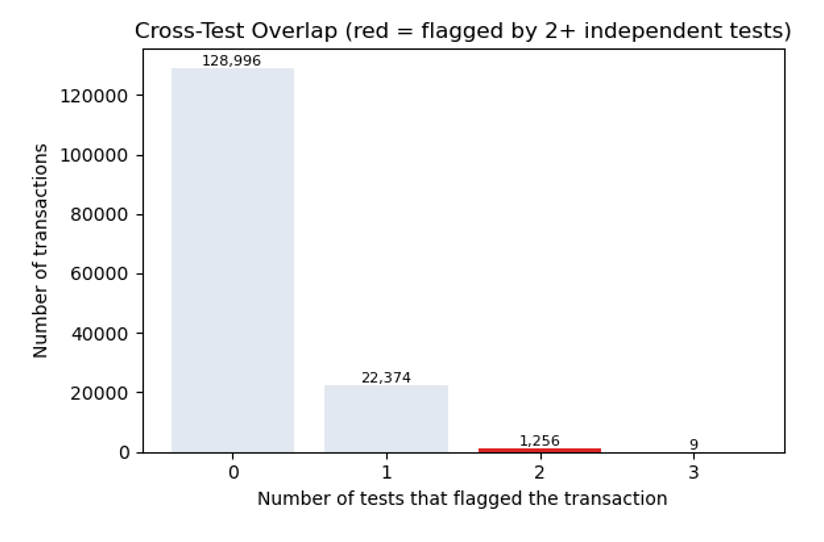
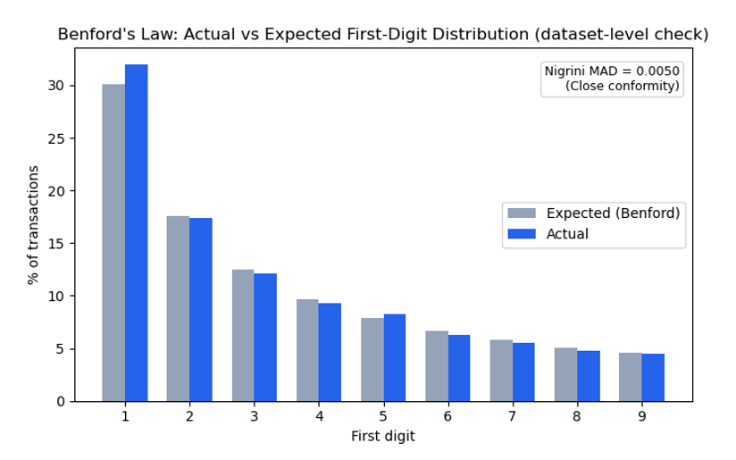
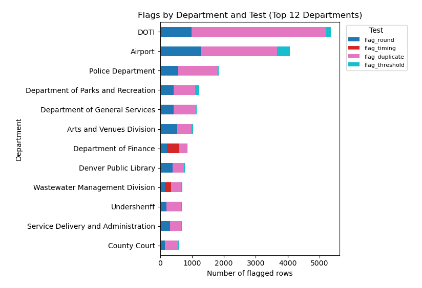

# Transaction Data Analytics in Python: City of Denver Payments (2025)

A rule-based transaction monitoring workflow built in Python (pandas) and run on 152,635 real
public-sector payment transactions. It screens the full population with five data checks,
ranks transactions by how many independent checks flag them, and narrows 150,000+ rows down to
a short, defensible list for human review.

The same approach is used in transaction monitoring (AML and fraud), spend and budget analysis
(FP&A), and data quality checks on any large financial dataset.

## Key results

| Metric | Result |
|---|---|
| Transactions analysed | 152,635 (from 154,596 raw rows) |
| Data checks run | 5 |
| Dataset integrity (Benford's Law, Nigrini MAD) | 0.005, close conformity |
| Transactions flagged by 2+ independent checks | 1,265 (0.83%) |
| Sample reviewed by hand | 15 transactions |
| False-positive pattern identified | Recurring flat-fee vendors in the duplicate check |
| Transactions escalated for follow-up | 2 |

## Skills demonstrated

- **Python / pandas:** cleaning, transforming and testing a 150,000+ row dataset
- **Transaction monitoring rules:** duplicate payments, round amounts, payments just below an approval threshold (structuring), period-end spikes
- **Statistical testing:** Benford's Law with Nigrini's MAD conformity score
- **Alert prioritisation:** scoring each transaction by the number of independent checks it triggers
- **Parameter sensitivity:** re-running rules at different settings to show how alert volumes change
- **False-positive review:** checking automated alerts by hand and refining the rule logic
- **Reporting:** plain-language write-up and charts for a non-technical reader

## Dataset

- **Source:** City of Denver Open Checkbook (also mirrored on Colorado's open data hub)
- **Scope:** calendar year 2025, all departments
- **Size:** 154,596 raw rows, 152,635 after excluding zero and negative amounts (credits, refunds and reversals, which are not genuine spend)
- **Structure note:** `RowId` is the unique line-item key. `PaymentId` groups several line items paid together in one batch, so it is not one row per transaction. This matters for the duplicate check.

This is real, unmodified data. There are no planted anomalies and no answer key, so every
flag means *worth a follow-up question*, not *confirmed issue*.

## The five checks

### 1. Benford's Law: dataset-level integrity check

Naturally occurring financial data follows a predictable first-digit pattern (digit 1 appears
about 30% of the time, digit 9 about 4.6%). Fabricated or manipulated figures tend to break
this pattern.

Benford's Law tells you whether a dataset as a whole looks natural, not whether a single
transaction is suspicious. Using it to flag individual rows would mark about 44% of the data
for no real reason, so it is used here only as a whole-dataset check.

**Result:** the data closely follows the expected curve (largest deviation 1.84 points, on
digit 1). Nigrini's MAD score is 0.005, which falls in the close-conformity band. The dataset
behaves like genuine financial data, which supports the four row-level checks below.

### 2. Round-number check

Genuine spend data rarely contains many exactly round amounts. This flags exact multiples of
$100, $500, $1,000 and $5,000.

**Result:** 8,265 transactions flagged (5.41%).

### 3. Period-end spending spike

Payment dates in this dataset are payment-run dates, so weekend or out-of-hours activity is
close to zero and not a useful signal. The check instead looks for departments whose December
spend is at least 2x their January to November monthly average, a common sign of
"use it or lose it" budget spending.

**Result:** 608 transactions flagged (0.40%). Several departments spent 2 to 5 times their
normal monthly amount in December.

### 4. Duplicate payment check

One `PaymentId` can legitimately contain repeated line items. The real signal is the same
payee, amount and expense category paid twice in separate payment runs within 30 days.

**Result:** 14,595 transactions flagged (9.56%), the highest rate of any check.

### 5. Threshold clustering (structuring) check

Denver's purchasing policy manual sets $10,000 as the point where a purchase needs agency-head
sign-off. Payments sitting just below that line can indicate amounts split or sized to avoid
approval, the same pattern AML teams look for as structuring.

**Result:** 1,445 transactions flagged (0.95%) in the $9,000 to $10,000 band.

## Parameter sensitivity

The 30-day duplicate window and the 90-100% threshold band are judgment calls. Re-running each
check at other settings shows how alert volumes respond:

| Duplicate window | Transactions flagged | Threshold band | Transactions flagged |
|---|---|---|---|
| 7 days | 5,054 (3.31%) | 99-100% ($9,900-$10,000) | 178 (0.12%) |
| 14 days | 8,103 (5.31%) | 95-100% ($9,500-$10,000) | 733 (0.48%) |
| 30 days (used) | 14,595 (9.56%) | 90-100% ($9,000-$10,000, used) | 1,445 (0.95%) |
| 60 days | 20,529 (13.45%) | 80-100% ($8,000-$10,000) | 2,810 (1.84%) |

## Alert prioritisation: cross-check overlap

With no answer key, the strength of a flag comes from how many independent checks agree. One
flag on its own can be coincidence; two or more is a much stronger signal.

| Checks triggered | Transactions |
|---|---|
| 0 | 128,996 |
| 1 | 22,374 |
| 2 | 1,256 |
| 3 | 9 |

**1,265 transactions (0.83%) were flagged by 2 or more independent checks.** Benford's Law is
not included in this count (see Check 1).

## Manual review

A random sample of 15 transactions flagged by 2+ checks was reviewed by hand to see whether the
alerts reflected real anomalies or normal business patterns.

**False-positive pattern found:** the duplicate check keeps flagging vendors paid the same flat
fee again and again, such as a towing company at $100 to $200 and a telecom provider at a fixed
monthly fee. These are routine, low-value, high-frequency payments. A refined rule would exclude
payee and amount pairs that recur often across the year, since frequent recurrence points to a
regular vendor relationship rather than a duplicate.

**Escalated for follow-up:** a $9,000 payment flagged by round-number + threshold clustering,
and a $9,097.92 payment flagged by duplicate + threshold clustering. Both combine two independent
signals with a meaningful amount just under the approval limit.

Row-by-row reasoning for all 15 transactions: **[manual_review.md](manual_review.md)**

## Recommended follow-up

- **Round amounts:** split by department to see whether they come from flat-fee contracts or from estimates keyed in at entry.
- **December spikes:** compare flagged departments' December spend against approved budgets and project timelines.
- **Duplicates:** exclude known high-frequency flat-fee vendors, then pull invoices for the remaining payee and amount pairs.
- **Threshold clustering:** request approval records for the two escalated payments.

## Limitations

- No confirmed anomalies exist in this data, so all flags are candidates for review, not findings.
- Credits, refunds and reversals were excluded.
- The weekend and time-of-day check does not suit this data and was replaced with the period-end spike check.
- Benford's Law is used only at dataset level, keeping the overlap count free of noise.
- The $10,000 threshold comes from Denver's own purchasing policy, not an assumption.
- The duplicate check over-flags recurring flat-fee vendors; the fix is described above.

## Files

| File | Contents |
|---|---|
| `NoteBook/Transaction_Data_Analytics.ipynb` | Full analysis: data loading, five checks, sensitivity, overlap, charts |
| `test_summary.csv` | Transactions flagged by each check |
| `spot_check_sample.csv` | The 15 transactions reviewed by hand |
| `manual_review.md` | Reasoning for each reviewed transaction |
| `Images/` | Charts used in this README |
| `Data/SOURCE.md` | Where to download the dataset |

## Tools

Python (pandas, numpy, matplotlib), Jupyter Notebook.

## Reproducing the analysis

1. Download the 2025 Denver Checkbook CSV (see `Data/SOURCE.md`) and save it as `data/City_of_Denver_Checkbook_2025.csv` next to the notebook, or set the `DENVER_CHECKBOOK_CSV` environment variable to its path.
2. Run `NoteBook/Transaction_Data_Analytics.ipynb` top to bottom.
3. The notebook writes `flagged_transactions.csv`, `spot_check_sample.csv` and the three charts.

## Author

Siddhant Wadhwa
